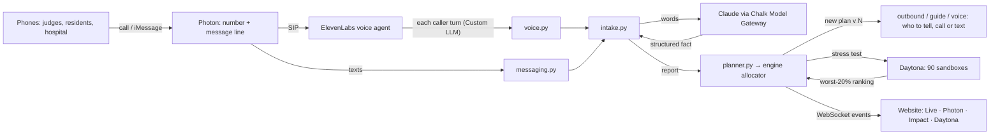

# EMBER — technical overview (for the demo and judge questions)

**EMBER is live disaster coordination.** People call (or text) and say what is happening; an AI agent understands them;
a deterministic simulator re-plans every vehicle in the district in about a second; everyone affected is told, by a
phone call at the moments that matter. Shown on a Charles River flood around the David Rubenstein Treehouse (Allston).

> **Real:** OpenStreetMap streets and buildings, the venue, Mount Auburn Hospital, the Cottage Farm CSO facility and MWRA
> outfall MWR201, MWRA's January 2024 discharge (≈80,700 m³). **Synthetic (labelled in the UI):** the households and their
> needs, flood timing, the fleet, backup-power endurance, sewage inflow, background traffic and passers-by.

---

## 1. The idea in one paragraph
Today a flood response plan is made once, from a forecast, and calls are handled one at a time as they arrive. The plan is
wrong by minute ten: a wheelchair nobody knew about, a street that's under water, a hospital on backup power. Shared
resources (the one accessible van, the one big generator) get committed early and never reconsidered. EMBER re-plans the
whole district every time someone speaks, explains every decision with simulated numbers, states the cost of each
trade-off, and stress-tests the plan against thousands of versions of the night so it holds up when things go wrong.

## 2. The one rule that makes it trustworthy (D76)
**The AI talks; the planner decides.** Models are used for exactly two things, both in the backend: turning what a person
said into a structured fact, and wording the reply. Every route, time, vehicle and assignment is computed by a
deterministic numpy simulator and planner. A guard rejects any model output that names a number, vehicle, place or street
the plan didn't produce. No LLM is in the simulation loop.

## 3. Architecture



| Layer | Folder | Tech | Job |
|---|---|---|---|
| Engine | `engine/` | Python 3.12, numpy, scipy, networkx, osmnx/geopandas/shapely (build time), Daytona SDK | Town, hazard, models, simulator, planner, baseline, comparison, Daytona robustness |
| Backend | `residents/` | FastAPI, uvicorn, SQLite, WebSocket, httpx, python-socketio (Photon), Anthropic SDK via Chalk | Shared state, API, Photon, ElevenLabs bridge, understanding, replies, calls, players |
| Website | `web/` | React 18, PixiJS 8 (isometric stage), deck.gl + MapLibre (flat fallback), Vite, TypeScript | Four judge views, live map, arrival alerts |
| Contracts | `contracts/` | JSON Schema + fixtures | The interface between the three; each side builds against fixtures |

## 4. The engine (deterministic, numpy)

**The town.** Built from OSM around the venue (`ember build`): 586 junctions, 1,196 road edges with lengths, lanes, speeds,
capacities and one-way flags, 17,810 OSM households, 11 assets. The flood scenario `allston_flood_v1` adds 40 assisted
households (synthetic needs), the facilities and the fleet.

**The hazard.** One interface for every hazard: `polygon_at(t_s)` and `closed_edges_at(t_s)`. The flood is a set of
keyframes (5–120 min) over real ground; roads close as the water reaches them. A second hazard (an ellipse plume) runs on
the same engine unchanged (D94).

**The models.**
- *Resources:* Van 1, Van 2, Accessible Van 3 (lift), **Ambulance 1** (stretcher, medical needs, 2 people, D114), a utility
  truck, a road crew, Generator 1 (500 kW, camlock), Generator 2 (150 kW, twist-lock). Speeds, capacities, fuel, time on scene.
- *Facilities:* Mount Auburn Hospital (backup endurance), the Putnam Ave substation, Cottage Farm CSO (storage, inflow,
  overflow to the Charles via MWR201), the EMS base, the Treehouse shelter.
- *Wastewater:* storage fills with inflow; without power the station overflows untreated sewage (m³).

**The plan simulator** (`sim/plan_sim.py`). Runs a whole plan forward on the road graph with closures over time in
milliseconds: when each vehicle reaches each household, who is reached before their flood deadline, hospital outage
minutes, overflow m³, vehicle-km, fuel.

**The planner** (`allocator/search.py`). Candidate plans from priority rules (deadline-first, needs-first, previous plan
kept, reserve use…), then local search on the best (120 moves first plan, 60 per replan); **every candidate is scored by
the simulator**. The objective is lexicographic: (1) people not reached before the water, (2) hospital outage, (3)
untreated overflow, then tie-breakers (plan changes, medical households not on an ambulance, fuel/km). Each decision
carries its counterfactual ("chosen over Cottage Farm: sending it there would mean hospital outage 13 → 215 min,
overflow 9,600 → 0 m³"). A replan takes about 0.7–1 s.

**The baseline** (`baseline.py`): the same fleet handling alerts in arrival order, incident by incident. Every metric on
screen is EMBER vs this baseline on the same reports.

## 5. Daytona (Tier 2) — "is the plan still safe?"
- **Why:** the forecast-best plan is fragile. EMBER runs every candidate (4 + the baseline) against thousands of perturbed
  worlds: travel-time multiplier 0.8–1.6, backup endurance 0.7–1.3, storage 0.7–1.3, inflow 0.85–1.15, storm timing.
  It keeps the plan with the best **worst 20%** (people first, then overflow) and only switches if that saves ≥ 1 person.
- **How:** `daytona/pool.py` keeps a **warm pool of 90 sandboxes** (Tier 2: 100 vCPU), started with the backend. A
  snapshot bakes the engine package and the town in (content-hashed name, e.g. `ember-engine-3884c8eb34`), because
  sandboxes have no internet; results come back as the `run_code` return value. Jobs are chunked; the batch setup
  (scenario + candidates + reports, ~60 KB) is zlib-compressed to ~8 KB and retried on dropped connections (D84). Pools are
  labelled with their owner so two processes never delete each other's sandboxes (D92).
- **Streaming:** each finished world is broadcast as a `scatter_point` WebSocket event; the Daytona view lights one cell
  per sandbox and plots every world.
- **Load-bearing:** the robust pick becomes the next published plan ("v6 · robust optimization").
- **Measured** (identical results, D86): 250 worlds 2.3 s laptop / 2.1 s Daytona · 1,000: 4.5 / 2.6 · 5,000: 13.7 / 4.0 ·
  **10,000: 24.3 / 5.3 s (4.6×)**. Tonight's integrated build: 10,000 worlds in 5.0–6.6 s fan-out. At 0:00 the robust pick
  leaves 15.7 people unreached in the worst 20% of worlds vs 30.3 for the forecast-best plan (baseline 40.8); after it the
  plan reaches 84 before the water (+28 vs baseline).
- **Endpoints:** `POST /optimize` (250 worlds), `POST /optimize?seeds=2000` (10,000), `GET /optimize` (progress/result).

## 6. Photon — the number and the multiplayer
- **The number** (346) 566-0512 is a Photon SIP trunk (`sip.photon.codes:5061`, TLS) imported into ElevenLabs, so calls
  go both ways: judges call in; EMBER calls out.
- **Messaging:** Photon 2.0 (`api.photon.codes/v1`) on a shared iMessage line: `POST /join` registers a phone (one
  assignment/seat each, idempotent, 409 when full, seats released for phones that never text), a socket listener receives
  texts, a text that can't be delivered becomes a call (D89, D90, D92). (`photon.py`, `messaging.py`)
- **Multiplayer:** an unknown caller becomes **Player N**, placed on a real household inside the forecast flood zone, with
  one replan per join burst (~0.8 s, `locate.py`). Every player shares one world: one person's report changes another
  person's pickup, and EMBER calls them with why.
- **On screen:** the Photon view (key 2) draws phones → Photon → AI reads → planner → told, with a card per player showing
  their last words and EMBER's reply.

## 7. ElevenLabs — the voice agents
- **EMBER is the agent's Custom LLM.** ElevenLabs does speech-to-text, turn-taking and the voice; each caller turn is POSTed
  to our OpenAI-compatible, streamed `/v1/chat/completions` behind a secret path on a cloudflared tunnel (`voice.py`). At
  start-up EMBER configures the agent: the custom-LLM URL, a system prompt carrying the caller id, the first message, the
  `end_call` tool, listening hints (street names, "wheelchair", "oxygen"), a 20 s silence hang-up.
- **Calls first (D100).** Calls at the moments that matter: first contact, the pickup, a changed pickup (with the reason),
  "2 minutes away", and **when a vehicle reaches a player the simulation pauses and their phone rings** (D112). Up to 3
  calls at once, most at-risk first; missed → one retry → a text.
- **Real speech handled:** re-sent and revised transcripts never count twice; stutters are stripped; silence gets "Are you
  still there?" then a goodbye; voicemail ends the call; "okay" once their pickup is known gets a spoken goodbye and
  `end_call`; "One moment…" is streamed if a turn takes > 1.2 s (D100, D107, D108, D110).
- **Tone:** one opening line, "Hi, this is EMBER, an automated flood-response assistant for this live demo.", then fully
  in-world and caring: a hurt caller hears who is coming and one thing to do; open questions get a specific answer from
  their situation. The only exception: an explicit "this is a real emergency" gets "please hang up and call 911" (D111).
- **Measured on real calls:** 0.6–1.4 s replies on short turns; 2–6 s when a long sentence goes to the model.

## 8. Chalk + Claude — understanding people
- **Every model call goes through Chalk's Model Gateway** (`api.chalk.ai/v1/router`, `X-Chalk-Env-Id`, model prefix
  `anthropic/`): `extract.anthropic_client` (D91).
- **Reading** (`extract.py`, `intake.py`): free speech → a typed fact (people, wheelchair/mobility, medical, urgent, a
  blocked street with its cross street, a facility's backup minutes). The fact becomes a report; the planner replans.
- **Answering** (`talk.py`, D111): open questions on a call get an answer from a sheet of what EMBER knows about this caller
  (vehicle, ETA, step, water time, closures, shelter, facilities), under the guard; 3.5 s limit, computed fallback.
- **Speed:** short call turns the keyword parser (`fallback.py`) reads with certainty skip the model (~1 s); long or unclear
  sentences use Claude (D108). With no model at all, texts and calls still work on the keyword parser.
- **Evaluated by outcome, not wording:** `scripts/eval_sim.py` feeds 51+ messages and checks, in the simulator, whether
  the household was reached in time with the right vehicle. Via Chalk: **50/51 pass, 0 fail, 100% safe** (D91; predates
  the newest fact kinds). Offline keyword parser: 53/59 pass, 0 fail.
- **On screen:** the Photon view's "AI reads" box shows **Claude via Chalk** (`/health.reader`).

## 9. One call, end to end (what happens in ~1–3 s)
1. A judge dials (346) 566-0512 → Photon SIP → ElevenLabs answers with EMBER's opening line.
2. They say "It's just me, I fell and hurt my leg, I can't walk." ElevenLabs posts the turn to `voice.py`.
3. Unknown number → registered as Player N, placed on a flood-zone home (replan).
4. The words → keyword parser (short, certain) or Claude via Chalk → fact: 1 person, medical, mobility.
5. `intake.py` stores the report; `planner.py` replans the district (~1 s): Ambulance 1 → this household.
6. `outbound.py` words the instruction from the plan; `speech.py` renders it for the phone; the guard checks it.
7. ElevenLabs speaks: "We've got you: Ambulance 1's paramedics know someone is hurt and come to your door in about N
   minutes. Keep the injured leg still."
8. WebSocket events update the website: the Player card, the decisions ticker, the plan version, the map.
9. Later, the ambulance reaches the door → the clock holds → EMBER calls: it's outside → the operator resumes.

## 10. The website (`web/`)
- **Live (1):** the isometric PixiJS stage (real OSM buildings, rising water over real ground elevation, closed roads,
  vehicles, traffic lights at the 35 real signalised junctions, illustrative traffic and passers-by), the score card vs
  baseline, the decisions ticker, the call-in QR.
- **Photon (2):** the multiplayer flow and Player cards. **Impact (3):** people reached, hospital outage, sewage kept out
  of the Charles, to scale vs Cottage Farm's real 80,700 m³; the plan-version timeline. **Daytona (4):** the stress test,
  the sandbox grid, worlds, seconds vs the laptop, the verdict.
- **Arrival alert:** "Van 3 reached Player 1 · Show · Resume"; Show zooms onto the home (D113).
- Data: `GET /state`, `/plan/current`, `/health`, `/calls`, `/optimize`, `/comparison`, `/playback` and the `/ws` event stream.

## 11. Backend API (FastAPI, `residents/residents/app.py`)
`/health` · `/state` · `/plan/current` · `/plan/{version}` · `POST /reports` · `/replan` · `/disruption` ·
`/assignments/{id}/confirm|reject` · `/simulate` · `/ask` · `/optimize` (POST/GET) · `POST /clock` (with the arrival hold
`held_by`, `resume`) · `/comparison` · `/playback` · `/phones` · `POST /join` · `/messages` · `/questions` · `/calls` ·
`/ws` · dev: `POST /dev/reset`, `POST /dev/inbound`. State lives in SQLite; every change is broadcast on the WebSocket.

## 12. Measured results (on screen in the demo)
| | EMBER | Incident-by-incident baseline |
|---|---|---|
| People reached before the water (plan v1) | **78** (84 after the Daytona pick) | 58 |
| Hospital outage after the power loss | **~13 min** | ~27 min |
| Untreated sewage before the hospital call | **0 m³** (5,167 m³ kept out) | 2,317–5,167 m³ |
| Replan | **~0.7–1 s** | — |
| 5-seed comparison after the hospital beat | 88.6 reached | 51.6 reached |

To save the hospital EMBER accepts 9,600 m³ of overflow and says so.

## 13. Testing and quality
- Engine 108 tests, backend ~390 tests, web build + behaviour checks (crowd, traffic, WebSocket), ruff clean, CI on every PR.
- `engine/scripts/e2e.py --big`: **88/88** against a live backend with real Daytona (every demo beat, joins and the cap,
  the arrival hold, 10,000-world stress test, both scenarios).
- `scripts/sim_calls.py`: simulated multi-caller calls (3 at once, a queue, a stranger calling in, missed calls, injuries,
  the police question) with the real planner; every real call tonight became a regression test (`test_voice.py`).
- Contracts (`contracts/*.schema.json`) with fixtures; changes bump the version (state 0.3, scenario 0.4, ws-events 0.2).

## 14. Running it
```bash
~/Ember/residents/scripts/demo_reset.sh            # or double-click "Reset EMBER" on the Desktop: fresh run, calls our phone
cd ~/Ember/web && VITE_API_BASE=http://127.0.0.1:8000 npm run dev   # site → localhost:43123/?live
curl -s -X POST localhost:8000/dev/reset           # quick reset (players stay)
cd ~/Ember/engine && uv run ember daytona-snapshot # after engine changes (~60 s)
```
Keys live in `residents/.env` (Photon, Chalk/Anthropic, ElevenLabs, `DEMO_PHONES`) and `engine/.env` (Daytona); never committed.

## 15. Judge questions — short answers
- **"Is the AI making the plan?"** No. It reads the sentence and words the reply; a deterministic simulator decides, and a
  guard blocks invented numbers, vehicles or streets.
- **"Why Daytona and not your laptop?"** Scale and isolation: 10,000 worlds in ~5 s vs ~24 s; it lets us pick the plan that
  survives the worst nights while people are still on the phone.
- **"How is Photon used?"** It is the number for calls in and out and the iMessage line; every judge who calls becomes a
  player in one shared world.
- **"Why Chalk?"** One gateway for every model call, swappable, and graded by outcomes in the simulator (50/51, 100% safe).
- **"What's real?"** Streets, buildings, the venue, the hospital, Cottage Farm and the MWRA figures. Households, needs,
  flood timing and the fleet are synthetic and labelled.
- **"What if the model is down?"** A keyword parser keeps texts and calls working; answers fall back to computed templates.
- **"What would it take to use for real?"** Real household data (311, utility outage feeds), a calibrated flood model from
  elevation data, an operator console; the coordination loop and the hazard interface stay the same.
- **"How is this different from forecast planners?"** They plan once in minutes to hours; EMBER replans in a second from
  what people report and calls each person with their own instruction.

## 16. Honest limits
Synthetic households and fleet; a quick cloudflared tunnel per run (a stable domain would remove a start-up step); the
model eval predates the newest fact kinds; ElevenLabs Starter credits and 3 concurrent calls bound the live demo; a
single injured caller gets the ambulance (it carries 2), larger households get the accessible van with a medical flag.
